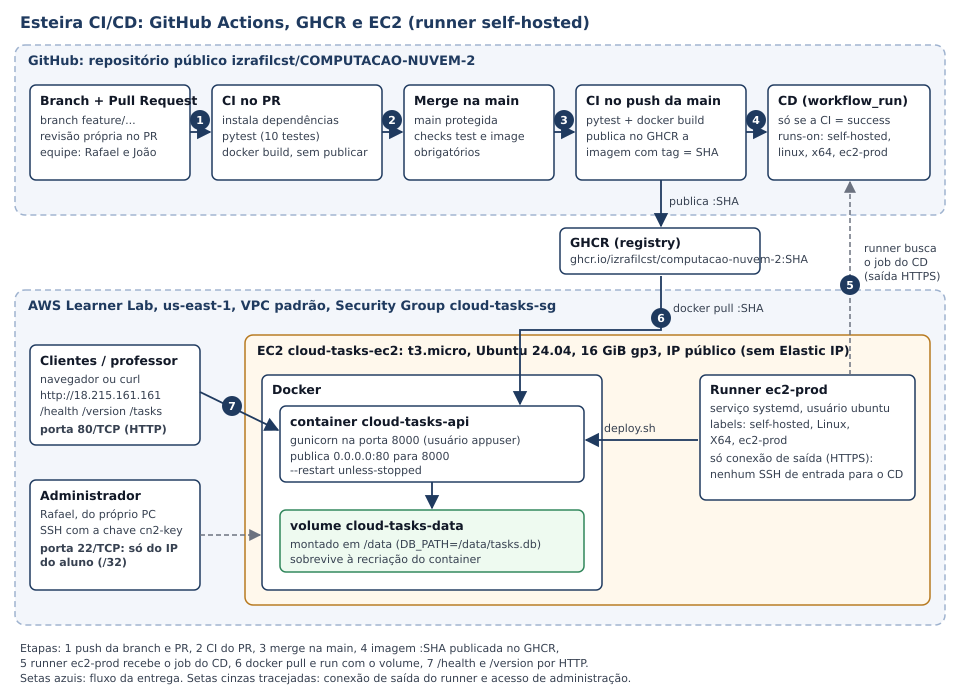

# Cloud Tasks API: esteira CI/CD na AWS

API de tarefas (Flask e SQLite) com esteira completa de **CI/CD: GitHub Actions, imagem Docker versionada por SHA no GHCR e deploy automático em uma EC2 da AWS** por runner self-hosted. Projeto final da disciplina de Computação em Nuvem.

## Integrantes

| Nome | RA |
|---|---|
| Rafael Alves de Sousa Costa | 22304563 |
| João Bernardo | 22300693 |

A dupla trabalhou em conjunto em todas as etapas. Detalhes na seção 11 do [relatório](docs/RELATORIO.md).

## Entrega

| Item | Link |
|---|---|
| Repositório | https://github.com/izrafilcst/COMPUTACAO-NUVEM-2 |
| API (IP público antes da parada) | `http://18.215.161.161/health` |
| Relatório (diagrama, infraestrutura, custos, persistência) | [docs/RELATORIO.md](docs/RELATORIO.md) |
| Evidências (prints) | [docs/evidencias/](docs/evidencias/) |
| Pull Requests | [#1](https://github.com/izrafilcst/COMPUTACAO-NUVEM-2/pull/1), [#2](https://github.com/izrafilcst/COMPUTACAO-NUVEM-2/pull/2), [#3](https://github.com/izrafilcst/COMPUTACAO-NUVEM-2/pull/3), [#4](https://github.com/izrafilcst/COMPUTACAO-NUVEM-2/pull/4) |
| CI aprovada em PR (DELETE) | [run 43430486134](https://github.com/izrafilcst/COMPUTACAO-NUVEM-2/actions/runs/43430486134) |
| CI aprovada no push da `main` | [run 43463371980](https://github.com/izrafilcst/COMPUTACAO-NUVEM-2/actions/runs/43463371980) |
| CD aprovado | [run 43463546742](https://github.com/izrafilcst/COMPUTACAO-NUVEM-2/actions/runs/43463546742) |

**Sobre o IP.** A API roda numa EC2 do AWS Academy Learner Lab. O timer da sessão termina por volta das **22:50 de 15/11/2026** (horário de Brasília). Nesse momento a EC2 é parada e, ao reiniciar a sessão, o IP público muda. O IP acima vale até a parada; o IP vigente na avaliação é informado no Moodle.

## Arquitetura



`Branch/PR -> CI (pytest + Docker build) -> merge na main -> CI (publica imagem no GHCR com tag = SHA) -> CD (runner self-hosted na EC2: docker pull + run) -> /health e /version`

## Rodar localmente

```bash
python -m venv .venv
# Linux/macOS: source .venv/bin/activate  |  Windows: .venv\Scripts\activate
pip install -r requirements-dev.txt
python -m pytest -q
python -m flask --app app.main run --port 5000
```

Ou execute `docker compose up --build` e abra `http://localhost:8080/health`.

## API

| Método | Rota | Função |
|---|---|---|
| GET | `/` | Informações |
| GET | `/health` | Saúde da aplicação e do banco |
| GET | `/tasks` | Lista tarefas |
| POST | `/tasks` | Cria tarefa (`{"title":"..."}`) |
| PATCH | `/tasks/<id>` | Atualiza conclusão (`{"done":true}`) |
| DELETE | `/tasks/<id>` | Exclui a tarefa (204 sem corpo; 404 se não existir) |
| GET | `/version` | Versão implantada (SHA do commit; `dev` fora do Docker de CI) |

Exemplos (troque `HOST` por `localhost:8080` ou pelo IP da EC2):

```bash
curl http://HOST/health
curl -X POST http://HOST/tasks -H 'Content-Type: application/json' -d '{"title":"Minha tarefa"}'
curl http://HOST/tasks
curl -X DELETE http://HOST/tasks/1
curl http://HOST/version
```

## Como a esteira funciona

- **CI** (`.github/workflows/ci.yml`): em PR e em push na `main`, instala dependências, roda `pytest` (10 testes) e faz o build Docker. Só o push na `main` publica a imagem `ghcr.io/izrafilcst/computacao-nuvem-2:<SHA>`; PR nunca publica nem faz deploy.
- **CD** (`.github/workflows/cd.yml`): dispara depois da CI com sucesso na `main`, no runner `ec2-prod` instalado na própria EC2. Implanta a imagem do commit aprovado com `scripts/deploy.sh`, mantém os dados no volume `cloud-tasks-data` e verifica `/health` e `/version`.
- **Persistência**: o SQLite fica em `/data/tasks.db`, dentro do volume do Docker, e sobrevive à recriação do container (prova no relatório, seção 7).

## Configuração e operação

- Configuração da AWS e do GitHub: [docs/CONFIGURACAO.md](docs/CONFIGURACAO.md).
- Passo a passo executado na AWS, com os prints exigidos: [docs/GUIA_AWS_ALUNO.md](docs/GUIA_AWS_ALUNO.md).

## Segurança e limitações didáticas

- Nenhuma chave, token ou segredo no repositório. O CD usa apenas o `GITHUB_TOKEN` efêmero do job.
- SSH (porta 22) restrito ao IP do aluno; o deploy não usa SSH de entrada porque o runner se conecta de dentro para o GitHub.
- O deploy é simplificado: sem TLS, balanceamento, rollback automatizado ou alta disponibilidade. Não coloque dados reais na API. O usuário do runner está no grupo `docker`, o que equivale a privilégio elevado na EC2; por isso a `main` é protegida e workflows de colaboradores externos exigem aprovação.
