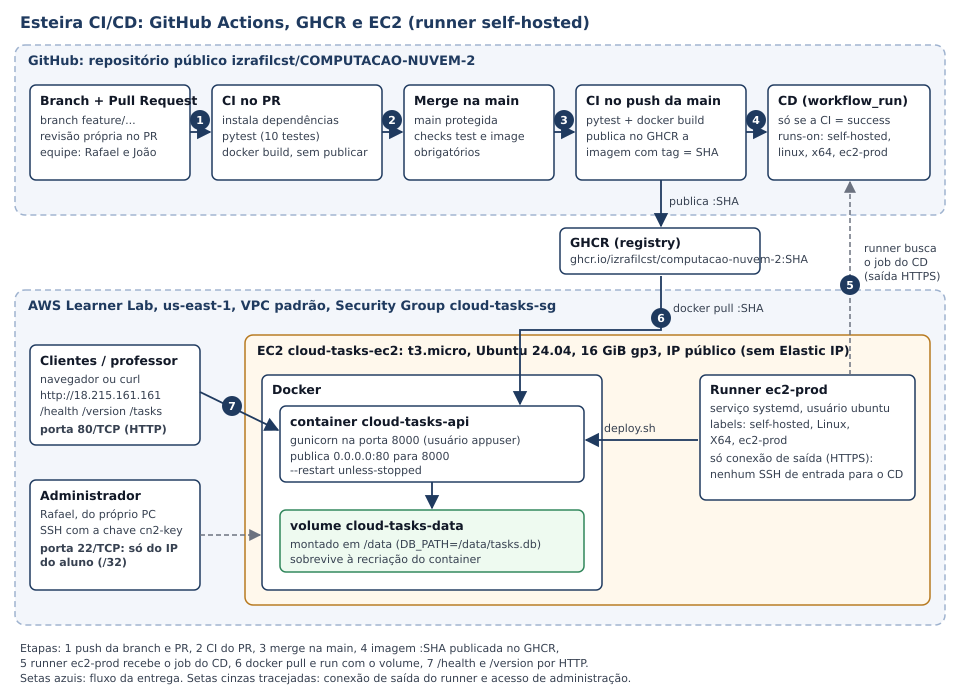
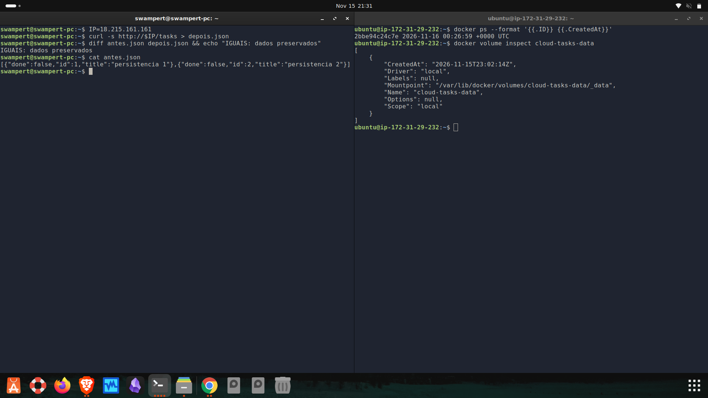

# Relatório final: esteira CI/CD de uma API na AWS

Disciplina: Computação em Nuvem. Equipe: dupla.

## 1. Identificação

| Item | Valor |
|---|---|
| Integrantes | Rafael Alves de Sousa Costa (RA 22304563) e João Bernardo (RA 22300693) |
| Repositório | https://github.com/izrafilcst/COMPUTACAO-NUVEM-2 (público) |
| Imagem no GHCR | `ghcr.io/izrafilcst/computacao-nuvem-2:<SHA do commit>` |
| API em execução | `http://18.215.161.161` (IP público da EC2 antes da parada) |
| Região AWS | us-east-1 (N. Virginia), conta AWS Academy Learner Lab |

**Atenção sobre o IP.** A sessão do Learner Lab tem timer e termina por volta das **22:50 de 15/11/2026** (horário de Brasília, UTC-3). Nesse momento a EC2 é parada e, ao reiniciar a sessão, recebe um novo IP público (não usamos Elastic IP). O IP `18.215.161.161` vale até a parada; o IP vigente na avaliação será informado no Moodle. Pela configuração (serviço systemd do runner habilitado e container com `--restart unless-stopped`), o runner e o container devem voltar sozinhos após o reinício.

## 2. Arquitetura

Fluxo: branch `feature/...` e Pull Request, CI do PR (pytest e docker build, sem publicar), merge na `main`, CI do push publica a imagem com tag igual ao SHA no GHCR, CD (`workflow_run`) roda no runner `ec2-prod` instalado na própria EC2, que faz `docker pull` da imagem do commit, recria o container com o volume `cloud-tasks-data` e confere `/health` e `/version`.

## 3. Infraestrutura, portas e rede

| Recurso | Configuração |
|---|---|
| Instância | `cloud-tasks-ec2` (`i-0d591769f9a45fc5e`), t3.micro, Ubuntu Server 24.04 LTS x86_64, 16 GiB gp3, sem IAM instance profile |
| Swap | 1 GB (`/swapfile`), por causa da RAM de 1 GB |
| Key pair | `cn2-key` (ed25519), arquivo `.pem` fora do repositório, `chmod 400` |
| Security Group | `cloud-tasks-sg` (`sg-03a0dd8f23379750b`), VPC padrão |
| Entrada 22/TCP (SSH) | somente o IP do aluno (`/32`), nunca `0.0.0.0/0` |
| Entrada 80/TCP (HTTP) | somente o IP do aluno (`/32`). Para a avaliação, a regra HTTP é aberta ao professor; a regra SSH permanece restrita |
| Saída | tudo liberado (o runner precisa de HTTPS de saída para o GitHub) |
| Runner | `ec2-prod`, serviço systemd, labels `self-hosted, Linux, X64, ec2-prod`, versão 2.338.2 |
| Container | `cloud-tasks-api`, gunicorn na porta 8000 como usuário `appuser`, publicado em `80:8000` |
| Volume | `cloud-tasks-data` montado em `/data` (`DB_PATH=/data/tasks.db`) |

O CD usa runner self-hosted porque o runner se conecta de dentro para o GitHub: não há SSH de entrada para o deploy nem secrets de SSH.

## 4. Esteira CI/CD

- **CI** (`.github/workflows/ci.yml`): em `pull_request` e em `push` na `main`. Job `test` (Python 3.12, `pip install`, `pytest`) e job `image` (docker build com `GIT_SHA`). A publicação no GHCR só acontece no `push` da `main`, com tag igual ao SHA do commit. PR nunca publica imagem nem dispara deploy.
- **CD** (`.github/workflows/cd.yml`): `workflow_run` da CI, apenas quando a conclusão é `success` e o evento original é `push`. Roda no ambiente `production`, com `concurrency` para um deploy por vez. Faz checkout do SHA aprovado, autentica no GHCR com o `GITHUB_TOKEN` efêmero do job (`packages: read`), executa `scripts/deploy.sh` e verifica `/health` e `/version` (o passo falha se a versão em execução não contém o SHA).
- **Proteções**: `main` protegida com os checks `test` e `image` obrigatórios; aprovação manual de workflows de colaboradores externos para todos (`all_external_contributors`).

## 5. Git, PRs e execuções

| PR | Branch | Conteúdo | CI do PR |
|---|---|---|---|
| [#1](https://github.com/izrafilcst/COMPUTACAO-NUVEM-2/pull/1) | `feature/version-endpoint` | `GET /version` com o SHA do commit | [run 43429961860](https://github.com/izrafilcst/COMPUTACAO-NUVEM-2/actions/runs/43429961860) |
| [#2](https://github.com/izrafilcst/COMPUTACAO-NUVEM-2/pull/2) | `feature/delete-task` | `DELETE /tasks/<id>` e testes | [run 43430486134](https://github.com/izrafilcst/COMPUTACAO-NUVEM-2/actions/runs/43430486134) |
| [#3](https://github.com/izrafilcst/COMPUTACAO-NUVEM-2/pull/3) | `feature/cd-self-hosted` | CD em runner self-hosted | [run 43430751762](https://github.com/izrafilcst/COMPUTACAO-NUVEM-2/actions/runs/43430751762) |
| [#4](https://github.com/izrafilcst/COMPUTACAO-NUVEM-2/pull/4) | `docs/guia-aws` | guia passo a passo da AWS | [run 43463199796](https://github.com/izrafilcst/COMPUTACAO-NUVEM-2/actions/runs/43463199796) |

Cada PR recebeu uma revisão própria (checklist) antes do merge, com CI aprovada.

- CI aprovada no `push` da `main`: [run 43463371980](https://github.com/izrafilcst/COMPUTACAO-NUVEM-2/actions/runs/43463371980) (commit `c965ce4`).
- **CD aprovado**: [run 43463546742](https://github.com/izrafilcst/COMPUTACAO-NUVEM-2/actions/runs/43463546742) (commit `c965ce468d7a674f4bd6b68807fc9d7642f54dd5`). A tentativa 2 foi o primeiro deploy; a tentativa 3 foi o re-run usado na prova de persistência.

## 6. Evolução funcional e testes

- `DELETE /tasks/<id>`: retorna 204 sem corpo quando exclui e 404 quando a tarefa não existe ou o id não é numérico. Três testes: `test_delete_task`, `test_delete_not_found`, `test_delete_twice_and_bad_id`.
- Melhoria adicional: `GET /version`, que devolve o SHA do commit em execução (variável `APP_VERSION`, preenchida pelo `GIT_SHA` do build). Dois testes: `test_version_default` e `test_version_from_env`. Ela permite provar que a versão implantada é a do commit aprovado.
- Suíte completa: 10 testes, todos passando na CI e localmente.

## 7. Persistência dos dados após recriar o container

Procedimento (ver `docs/GUIA_AWS_ALUNO.md`, seção 7):

1. Configuração: `DB_PATH=/data/tasks.db` e `/data` é o volume nomeado `cloud-tasks-data` ([12](evidencias/12-persistencia-config.png)).
2. Criamos duas tarefas e salvamos a lista em `antes.json`: `[{"done":false,"id":1,"title":"persistencia 1"},{"done":false,"id":2,"title":"persistencia 2"}]` ([13c](evidencias/13c-dados-antes.png)).
3. Destruímos o container com `docker rm -f cloud-tasks-api`; o `docker ps -a` ficou vazio e o `docker volume ls` manteve `cloud-tasks-data` ([13a](evidencias/13a-container-destruido.png)).
4. Re-executamos o CD (tentativa 3 do run 43463546742), que terminou verde ([13b](evidencias/13b-cd-rerun-verde.png)).
5. `diff antes.json depois.json` não mostrou diferenças ([13](evidencias/13-persistencia-antes-depois.png)).

| | Container antes | Container depois |
|---|---|---|
| ID | `9c49dc69b3cc…` | `2bbe94c24c7e…` |
| Criado em (UTC) | 2026-11-15 23:02:18 | 2026-11-16 00:26:59 |
| Fonte | log do CD, tentativa 2, e [05](evidencias/05-docker-sem-sudo.png) | log do CD, tentativa 3, e [13](evidencias/13-persistencia-antes-depois.png) |

O volume `cloud-tasks-data` foi criado em 2026-11-15 23:02:14 UTC, antes do primeiro container, e continuou o mesmo (`Mountpoint` em `/var/lib/docker/volumes/cloud-tasks-data/_data`). Os IDs completos aparecem nos logs do passo "Deploy da imagem imutavel" de cada tentativa.

## 8. Segurança

- Nenhuma chave, token ou segredo no código, nos logs ou no README. O CD usa apenas o `GITHUB_TOKEN` efêmero do job; o token de registro do runner foi gerado na hora e não foi gravado.
- SSH (porta 22) restrito ao IP do aluno. O deploy não depende de SSH de entrada.
- Os prints do console AWS tiveram o ID da conta e o e-mail ocultados, por o repositório ser público.
- Limitações didáticas conhecidas: sem TLS (HTTP puro), dados fictícios, e o runner roda como usuário do grupo `docker` (equivale a privilégio elevado na EC2). Por isso o repositório exige aprovação para workflows externos e a `main` é protegida.

## 9. Custos e recursos

| Campo | Valor |
|---|---|
| Região | us-east-1 |
| Tipo da instância | t3.micro |
| Preço por hora | US$ 0,0104 (On-Demand Linux, mostrado pelo console no lançamento) |
| Início (UTC-3) | 15/11/2026 19:55 |
| Fim | **pendente**: preencher no encerramento (seção 11) |
| Disco EBS | gp3, 16 GiB |
| Elastic IP | não usado |
| Orçamento do Learner Lab | US$ 50 (uso de US$ 0 no início da sessão) |
| Custo final | **pendente**: valor do painel do Learner Lab após o encerramento |

## 10. Dificuldades e decisões

- **CD na fila antes de existir runner.** Os PRs #2 e #3 foram integrados antes do runner estar online; os runs do CD ficaram na fila e foram cancelados. Depois que o runner `ec2-prod` ficou ativo, re-executamos o CD do commit `c965ce4` (sem novo merge).
- **AMI padrão diferente da exigida.** O console passou a oferecer Ubuntu 26.04 por padrão; selecionamos manualmente o 24.04 LTS, que é o do guia e do script de instalação do Docker.
- **Particularidades do Learner Lab.** Região limitada, key pair `vockey` pré-existente (mantido, não apagamos) e sessão com timer: a EC2 é parada no fim da sessão e o IP muda ao religar (item 1).
- **Prints com dados da conta.** O console exibe ID da conta e e-mail; ocultamos antes de salvar os prints.

## 11. Distribuição das tarefas e encerramento

**Tarefas.** A dupla trabalhou em conjunto em todas as etapas (código e testes, workflows, AWS, documentação), com revisão mútua. Os commits foram enviados pela conta GitHub do Rafael. Ambos os integrantes sabem explicar cada parte.

**Encerramento dos recursos (pendente, após a avaliação).** Remover o runner do GitHub, terminar a instância (Terminate, não Stop), conferir volumes e snapshots, apagar o Security Group `cloud-tasks-sg` e o key pair `cn2-key` (o `vockey` do laboratório permanece), e registrar a hora de término e o custo final na seção 9. As evidências de encerramento (P16 a P19 do guia) serão adicionadas a `docs/evidencias/`.

## 12. Evidências (`docs/evidencias/`)

| Arquivo | Mostra |
|---|---|
| `01-key-pair.png` | key pair `cn2-key` (ed25519) criado |
| `02-sg-inbound.png` | portas 22 e 80 só com o IP do aluno (`/32`) |
| `03-instancia-running.png` | EC2 `Running` com status checks aprovados |
| `04-ssh-conectado.png` | acesso SSH ao Ubuntu 24.04 |
| `05-docker-sem-sudo.png` | Docker sem `sudo`, usuário no grupo `docker` |
| `06-swap.png` | swap de 1 GB |
| `07-runner-idle.png` | runner `ec2-prod` `Idle` com os 4 labels |
| `08-runner-servico.png` | serviço do runner `active (running)` |
| `09-cd-verde.png` | CD verde com `/health` e `/version` no log |
| `10a-health.png`, `10b-version.png` | API respondendo por HTTP e versão igual ao commit |
| `11-docker-ps-ec2.png` | container `cloud-tasks-api` com a tag do SHA |
| `12-persistencia-config.png` | `DB_PATH` e volume nomeado montado em `/data` |
| `13a`, `13b`, `13c` e `13-persistencia-antes-depois.png` | container destruído, CD refeito, dados antes e comparação final |

As evidências de `/version` e do container (`09`, `10b`, `11`) foram coletadas no deploy do commit `c965ce4`. Commits posteriores a ele alteram apenas documentação.
